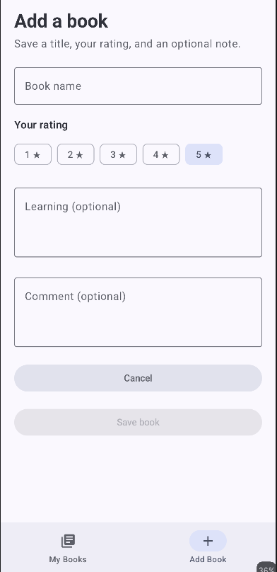

  

# Bookstore

> Die aktuelle Version der App kann auf der Seite [Releases](https://github.com/chooklii/Bookstore/releases) heruntergeladen werden.

> The current version of the app is available on the [Releases](https://github.com/chooklii/Bookstore/releases) page.

## Deutsch

Bookstore ist eine Android-App zur Verwaltung der persönlichen Bücherliste. Die Bücher werden lokal auf dem Gerät gespeichert.

### Funktionen

- **Bücherübersicht:** Alle gespeicherten Bücher werden übersichtlich in einer Liste angezeigt.
- **Bücher hinzufügen:** Titel, Bewertung von 1 bis 5 Sternen sowie optionales Learning und einen Kommentar erfassen.
- **Bücher bearbeiten:** Ein Eintrag kann durch Antippen geöffnet und anschließend verändert werden.
- **Bücher suchen:** Die Liste lässt sich über ein Suchfeld nach dem Namen des Buches filtern.
- **Suche zurücksetzen:** Mit dem Aktualisieren-Symbol werden alle Suchbegriffe entfernt und die komplette Liste angezeigt.
- **Lokale Speicherung:** Alle Daten bleiben auf dem Gerät erhalten und sind ohne Internetverbindung verfügbar.

### Übersicht

### Buch hinzufügen

## English

Bookstore is an Android app for managing a personal bookshelf. Books are stored locally on the device.

### Features

- **Book overview:** View all saved books in a clear list.
- **Add books:** Enter a title, a rating from 1 to 5 stars, and optional learning notes and comments.
- **Edit books:** Tap an entry to open it and update its details.
- **Search books:** Filter the list by book name using the search field.
- **Reset search:** Use the refresh icon to clear the search and show the complete list.
- **Local storage:** Data remains on the device and is available without an internet connection.

### Overview

### Add a book

